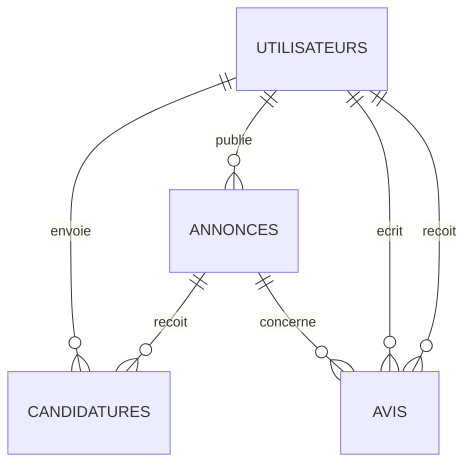
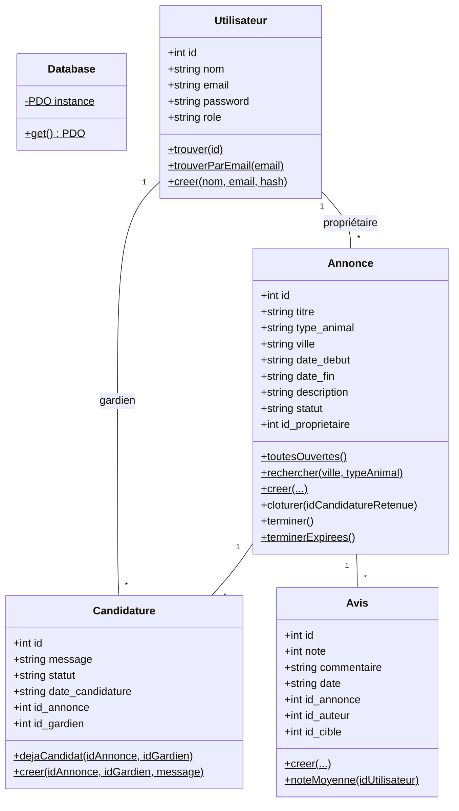

# PetSitter Local

Application web de mise en relation entre propriétaires d'animaux et gardiens bénévoles.
PHP 8 (POO), MySQL, architecture MVC.

## Installation

1. Copier le dossier dans `C:\xampp\htdocs\`.
2. Démarrer Apache et MySQL dans XAMPP.
3. Importer `sql/petsitter.sql` dans phpMyAdmin (crée la base `petsitter` et le jeu de données).
4. Ouvrir http://localhost/PetSitter-Local/public/

Comptes de test (mot de passe : `motdepasse`) :

| Email | Rôle | Situation |
|---|---|---|
| admin@petsitter.fr | admin | accès à l'espace admin |
| alice@petsitter.fr | membre | propriétaire de 3 annonces (ouverte, pourvue, terminée) |
| bruno@petsitter.fr | membre | gardien, peut encore noter Alice (annonce 4) |
| chloe@petsitter.fr | membre | gardienne |
| david@petsitter.fr | membre | propriétaire de 2 annonces |

## Architecture MVC

```
public/index.php        Routeur unique : lit ?action=... et appelle le bon contrôleur
public/css/style.css    Feuille de style
config/database.php     Connexion PDO partagée (classe Database)
app/models/             Modèles : requêtes SQL (Utilisateur, Annonce, Candidature, Avis)
app/controllers/        Contrôleurs : logique et contrôle d'accès
app/views/              Vues : affichage HTML uniquement
app/helpers/            Fonctions communes (session, validation, affichage)
sql/petsitter.sql       Création de la base + jeu de données
```

Parcours d'une requête : `index.php` → contrôleur → modèle (SQL) → contrôleur → vue (HTML).

| Module | Contrôleur | Actions |
|---|---|---|
| Socle commun | `AuthController` | inscription, connexion, deconnexion |
| A — Propriétaire | `AnnonceController` | accueil, creer, modifier, supprimer, mesAnnonces, candidatures, valider, terminer |
| B — Gardien | `AnnonceController` / `CandidatureController` | liste, rechercher, fiche / postuler, retirer, mesCandidatures, profil |
| C — Avis & Admin | `AvisController` | noter, admin, supprimerAvis, supprimerUtilisateur |

## Schéma relationnel (MLD)

- **utilisateurs** (<u>id</u>, nom, email, password, role)
- **annonces** (<u>id</u>, titre, type_animal, ville, date_debut, date_fin, description, statut, #id_proprietaire)
- **candidatures** (<u>id</u>, message, statut, date_candidature, #id_annonce, #id_gardien)
  — unique (id_annonce, id_gardien)
- **avis** (<u>id</u>, note, commentaire, date, #id_annonce, #id_auteur, #id_cible)
  — unique (id_annonce, id_auteur)



## Diagramme de classes



## Cycle de vie d'une annonce

```
ouverte ──(le propriétaire valide un gardien)──► pourvue ──(date de fin passée, ou clôture manuelle)──► terminee
```

### Clôture : `Annonce::cloturer($idCandidatureRetenue)`

Quand le propriétaire choisit un gardien, trois requêtes sont exécutées dans une **transaction**
(soit elles réussissent toutes, soit aucune n'est appliquée) :

1. la candidature choisie passe à `acceptee` ;
2. toutes les autres candidatures de l'annonce passent à `refusee` ;
3. l'annonce passe à `pourvue`.

Le contrôleur vérifie avant que l'utilisateur est bien le propriétaire et que l'annonce est encore `ouverte`,
ce qui garantit un seul gardien par annonce.

### Fin de garde

- **Automatique** : à chaque chargement de page, `Annonce::terminerExpirees()` passe à `terminee`
  toutes les annonces `pourvue` dont la `date_fin` est dépassée.
- **Manuelle** : le propriétaire peut cliquer sur « Marquer la garde comme terminée ».

Le statut `terminee` débloque la notation.

### Notation et note moyenne : `Avis::noteMoyenne($idUtilisateur)`

- Seuls le propriétaire et le gardien retenu peuvent noter, chacun notant l'autre (`id_cible`).
- Un seul avis par personne et par garde : vérifié en PHP (`Avis::dejaNote`) et en base (clé unique).
- La note moyenne est calculée par MySQL : `SELECT AVG(note) FROM avis WHERE id_cible = ?`.
  Si l'utilisateur n'a reçu aucun avis, `AVG` renvoie `NULL` et le site affiche « Pas encore noté ».

## Sécurité

- Mots de passe hachés avec `password_hash()` et vérifiés avec `password_verify()`.
- Toutes les requêtes avec des données utilisateur sont des requêtes préparées PDO (`?`).
- Tout affichage passe par `htmlspecialchars()` (protection XSS).
- Contrôle d'accès : `requireLogin()`, `requireAdmin()`, et vérification du propriétaire avant
  de voir les candidatures, valider un gardien ou clôturer une garde.
- Vérification des formulaires côté serveur (`app/helpers/validation.php`).
