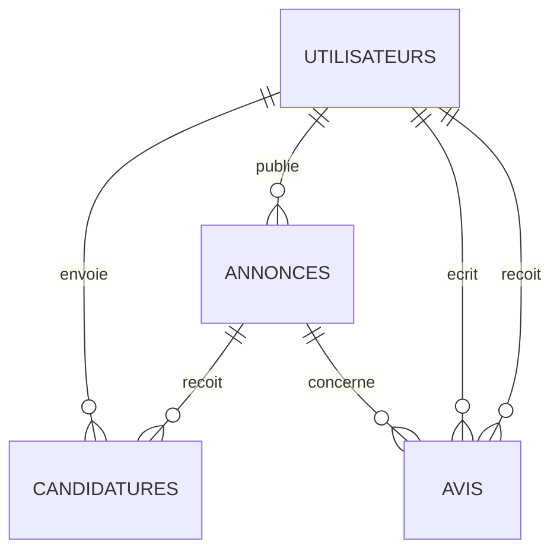
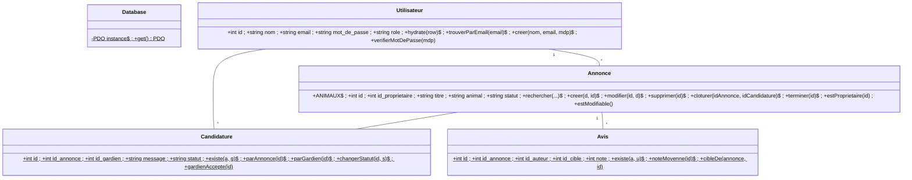

# PetSitter Local

Application web de mise en relation entre propriétaires d'animaux et gardiens bénévoles.
Projet BTS SIO SLAM : PHP 8 (POO), MySQL, architecture MVC.

## Installation

1. Copier le dossier dans `C:\xampp\htdocs\`.
2. Démarrer Apache et MySQL dans XAMPP.
3. Importer `sql/petsitter.sql` dans phpMyAdmin (crée la base `petsitter` et le jeu d'essai).
4. Ouvrir http://localhost/PetSitter-Local/public/

Comptes de test (mot de passe : `password123`) :

| Email | Rôle | Situation dans le jeu d'essai |
|---|---|---|
| admin@petsitter.test | admin | accès à l'espace admin |
| alice@petsitter.test | user | propriétaire de Mochi (ouverte) et Rex (pourvue) |
| bob@petsitter.test | user | a postulé à Mochi ; propriétaire des poissons et de Pixel |
| chloe@petsitter.test | user | gardienne acceptée pour Rex ; propriétaire du hamster |

`config/app.php` : `APP_ENV = 'dev'` affiche les erreurs, `'prod'` affiche un message générique.

## Architecture MVC

```
public/index.php        Routeur unique : sécurité, session, autoload, e(), redirect(), match des actions
public/css/style.css    Feuille de style
config/app.php          Environnement (dev / prod)
config/database.php     Connexion PDO unique (singleton Database::get())
app/core/               Classes transverses : Securite (CSRF), Affichage (mise en forme du design)
app/models/             Modèles : SQL + règles métier (Utilisateur, Annonce, Candidature, Avis)
app/controllers/        Contrôleurs : droits, validation, appel du modèle, choix de la vue
app/views/              Vues : HTML uniquement, tout affichage passe par e()
sql/petsitter.sql       Structure + jeu d'essai
```

Trajet d'une requête : `index.php?action=detail&id=1` → `AnnonceController::detail()` →
`Annonce::trouver(1)` (requête préparée, `hydrate()`) → vue `annonces/detail.php`.

| Module | Contrôleur | Actions |
|---|---|---|
| Socle | `AuthController` | connexion, inscription, deconnexion |
| A — Annonces | `AnnonceController` | accueil, liste, detail, creer, modifier, supprimer, terminer, mes_annonces |
| B — Candidatures | `CandidatureController` | postuler, retirer, mes_candidatures, recues, repondre |
| C — Avis | `AvisController` | noter, profil |
| Admin | `AdminController` | admin, supprimer_avis, supprimer_utilisateur |

## Schéma relationnel (MLD)

- **utilisateurs** (<u>id</u>, nom, email, mot_de_passe, role, created_at)
- **annonces** (<u>id</u>, #id_proprietaire, titre, animal, description, ville, date_debut, date_fin, statut, created_at)
- **candidatures** (<u>id</u>, #id_annonce, #id_gardien, message, statut, created_at) — UNIQUE (id_annonce, id_gardien)
- **avis** (<u>id</u>, #id_annonce, #id_auteur, #id_cible, note, commentaire, date) — UNIQUE (id_annonce, id_auteur)



## Diagramme de classes



## Cycle de vie d'une annonce (machine à états)

| Départ | Événement | Arrivée | Qui |
|---|---|---|---|
| ouverte | le propriétaire accepte une candidature | pourvue | propriétaire |
| pourvue | le propriétaire marque la garde terminée (ou date de fin passée) | terminee | propriétaire / automatique |
| ouverte | le propriétaire supprime l'annonce | (supprimée) | propriétaire |
| pourvue / terminee | modifier, supprimer, postuler | interdit | personne |

**Clôture : `Annonce::cloturer($idAnnonce, $idCandidature)`** exécute trois `UPDATE` dans une
**transaction** (tout ou rien) : la candidature choisie devient `acceptee`, les autres en attente `refusee`,
l'annonce `pourvue`. En cas d'erreur, `rollBack()` annule tout.

**Note moyenne : `Avis::noteMoyenne($id)`** = `SELECT AVG(note) FROM avis WHERE id_cible = :id`,
arrondie à une décimale ; `null` (« Pas encore d'avis ») si l'utilisateur n'a reçu aucun avis.
`Avis::cibleDe()` décide qui note qui : le propriétaire note le gardien accepté et inversement.

## Sécurité

- Requêtes préparées PDO partout (paramètres nommés `:id`).
- `e()` sur tout affichage (XSS) ; `nl2br(e(...))` pour les textes longs.
- `password_hash()` / `password_verify()`, `rehasherSiNecessaire()`.
- Jeton **CSRF** dans chaque formulaire POST (`Securite::champ()` / `verifier()` / `exigerPost()`).
- Actions d'écriture en POST uniquement (405), déconnexion comprise.
- Codes **403** (pas le droit), **404** (introuvable), **405** (mauvaise méthode), **400** (valeur falsifiée).
- Liste blanche des champs (`lireFormulaire()`), des animaux (`Annonce::ANIMAUX`), des décisions, du tri.
- Session durcie (`use_strict_mode`, `httponly`, `samesite=Lax`), `session_regenerate_id()` à la connexion.
- Blocage 60 s après 5 mots de passe erronés ; message identique pour email inconnu et mauvais mot de passe.
- En-têtes `X-Content-Type-Options`, `X-Frame-Options`, `Referrer-Policy` ; gestionnaire d'exceptions dev / prod.

Limites connues : pas de HTTPS en local, compteur de tentatives stocké en session,
pas de Content-Security-Policy (JavaScript inline `onsubmit`), pas de journal d'audit.

## Écart avec le support de cours

Le support utilise le type de retour `never` (PHP 8.1) pour `redirect()`. XAMPP fournit PHP 8.0 :
on écrit `void`, le comportement est identique puisque la fonction se termine par `exit`.
